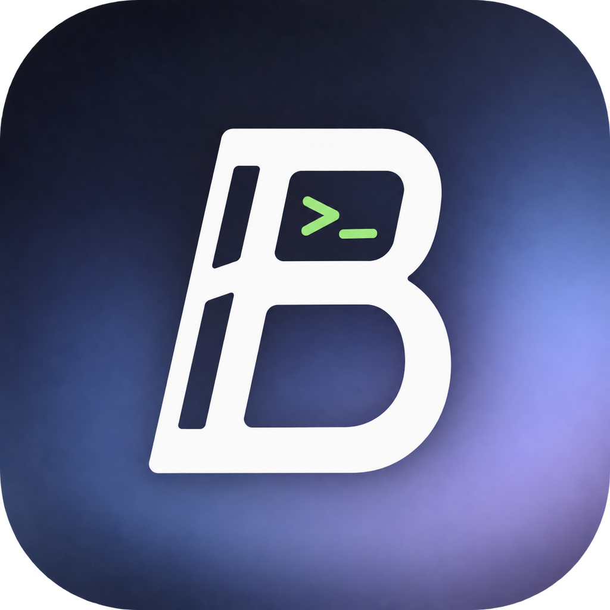
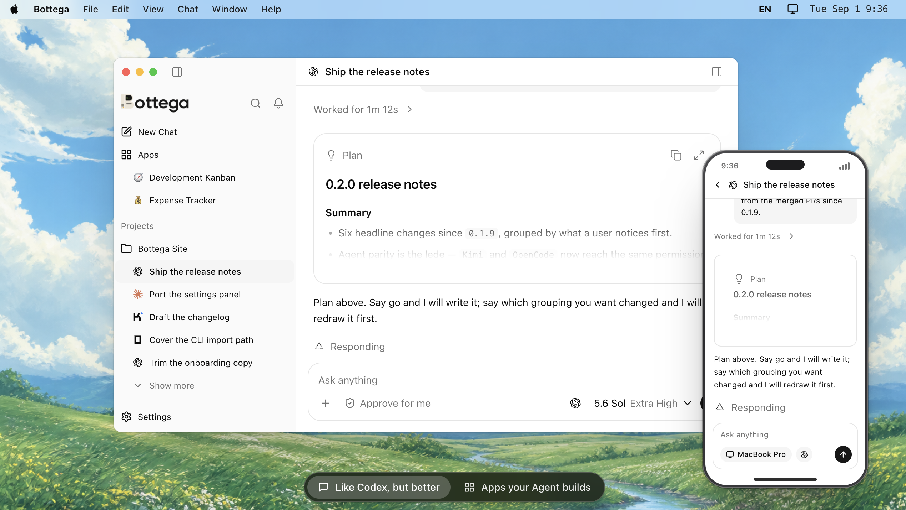

<p align="center">
  
</p>

<h1 align="center">Bottega</h1>

<p align="center"><strong>The workshop that builds itself.</strong></p>

<p align="center">
  Bottega is an open-source, local-first desktop workspace for Codex, Claude Code, Kimi Code, and OpenCode.<br>
  Turn Agent conversations into durable workspaces with Base, Apps, Memory, browser tools and native subagents. Credentials stay with the official local CLIs.
</p>

<p align="center">
  <a href="https://github.com/thinkingjimmy/Bottega/tree/main"></a>
  <a href="https://github.com/thinkingjimmy/Bottega/stargazers"></a>
  <a href="./LICENSE"></a>
</p>

<p align="center">
  <a href="https://www.getbottega.app">Website</a> ·
  <a href="./docs/README.md">Docs</a> ·
  <a href="./docs/getting-started/README.md">Quickstart</a> ·
  <a href="https://github.com/thinkingjimmy/Bottega/releases/latest">Download</a> ·
  <a href="./docs/features/README.md">Features</a> ·
  <a href="./docs/changelog/README.md">Changelog</a> ·
  <a href="https://x.com/hellojimmywong">X</a>
</p>

<p align="center">
  <strong>English</strong> | <a href="./docs/README.zh-CN.md">简体中文</a>
</p>

<p align="center">
  
</p>

This source is version **0.4.5**, using **protocol 27**. The [latest stable Release](https://github.com/thinkingjimmy/Bottega/releases/latest) owns installer availability and its accepted platforms; a source version does not certify publication or package acceptance.

# Key features

- **Your Agents, one sidebar.** Run Codex, Claude Code, Kimi Code, and OpenCode through their official local CLIs. Switch Agents for the next turn in an idle chat while keeping the same transcript.
- **Build the workspace you need.** Combine pages, Widgets, tools, services and Chat modes in one plugin. Manage official features, existing Apps and personal plugins together, with source Projects, managed dependencies and version recovery.
- **Work with Artifacts.** Edit native Canvas, Slides, Design System and Dashboard work. Send feedback from the original Chat, restore History and export complete project ZIPs.
- **Sketch your next prompt.** Draw, add text and shapes, and erase details in the composer. Keep sketches editable until they are sent as PNG images.
- **Build AI-native Apps.** Describe the workflow you need and turn it into a durable App with its own interface, data, and permissions—not another result trapped in a transcript.
- **Customize by chatting.** Use multiple Chats in one plugin source Project. Valid builds update local instances automatically; failed builds keep the working version. Rebuild eligible isolated Apps from their retained source.
- **Keep useful tools close.** Add Weather, AI Limits, AI Usage and Tasks to Dock. Choose a city for each Weather Widget. Use native Provider subagents and ordinary Chat forks for parallel work.
- **Every Chat, one data space.** Give a Chat or Project a structured Base, then work with the same rows as a table, list, Kanban board, map, chart, or gallery.
- **Sync it, or keep it local.** Everyone starts on this computer. Sign in when you want your work on more than one device: content is end-to-end encrypted with a sync password that only you hold, and the server never sees your plain text.
- **Reach the computer that holds the work.** Signing in publishes that computer's sidebar to your account. Switch computers in the sidebar from a browser, a phone, or another desktop, and drive the one you need.
- **Open your workspace in a browser.** Sign in at [app.getbottega.app](https://app.getbottega.app) to read and edit your Chats, Bases, and Apps from another computer or a phone.

[Explore the complete feature guide →](https://www.getbottega.app/features/agents/)

# Get started

Choose a prebuilt desktop release or run Bottega directly from source. Before launching, install and authenticate at least one supported CLI: Codex, Claude Code, Kimi Code, or OpenCode.

## Download

[Download the latest stable release →](https://github.com/thinkingjimmy/Bottega/releases/latest)

| Platform | Download |
| --- | --- |
| macOS (Apple silicon / ARM64) | [DMG or ZIP](https://github.com/thinkingjimmy/Bottega/releases/latest) |

Version 0.4.5 targets **macOS on Apple silicon (ARM64)**. Choose the installer and accepted platform listed on the latest stable Release. Official stable installers use the automatic-update channel.

**Updating:** 0.2.6 and 0.2.7 installations use the stable update channel. The shipped 0.2.5 personal build has its updater disabled and requires a manual installation from the latest stable Release. Before replacing the app, quit Bottega completely and back up your Bottega folder and application data.

0.4.5 uses **protocol 27**. See the [upgrade guide](./docs/getting-started/README.md#upgrading-to-045) for the desktop update and the 0.4.2 retirement scope.

For an official release, use its **Developer ID signed and Apple notarized** DMG or ZIP and the release-evidence archive attached to that same Release. Read `release-manifest.json` at the archive’s root. Run `shasum -a 256` on the installer and compare the result with its `sha256` in the manifest, then copy Bottega into `Applications`. See the [installation guide](./docs/getting-started/README.md#download-and-install) for the commands.

**Historical validation:** 0.2.7 was published by owner decision before complete local and final-package GUI acceptance. It has no complete acceptance evidence archive. Those facts remain specific to 0.2.7; its Release page lists the actual assets.

Bottega drives the Codex, Claude Code, Kimi Code, and OpenCode CLIs already installed and logged in on your machine. On first launch, pick your Bottega folder, let Bottega detect the CLIs, then create a task and choose its Agent before sending the first message. Setup never asks about an account: signing in is a later step, from Settings.

Ordinary Codex Chat uses its native App Server and checks the actual protocol and required capabilities before sending input. Quota queries and optional updates are independent. Native generated titles and isolated editor tasks keep their separate **CLI 0.163.0-alpha.10.2** qualification. Ask for approval and Approve for me allow network access, temporary-directory writes and ordinary reads outside the workspace. Plan does not enforce filesystem read-only access. Read the [Codex permission changes](./docs/features/README.md#codex-command-permissions) and the [supported CLI versions](./docs/getting-started/README.md#requirements) before starting.

## Build from source

Requires a Mac with Apple silicon. This source pins Node.js 24.21.0 and pnpm 11.9.0.

```bash
git clone --recurse-submodules https://github.com/thinkingjimmy/Bottega.git
cd Bottega
npm install --global pnpm@11.9.0
pnpm install --frozen-lockfile
node apps/desktop/scripts/node-runtime/fetch-node.mjs --dev-manifest
pnpm dev
```

To create a production build or a local installer:

```bash
pnpm build
pnpm dist
```

A signed distribution requires your own Apple signing configuration. Find official release installers and their verification records on the [Releases page](https://github.com/thinkingjimmy/Bottega/releases/latest). See the [getting-started guide](./docs/getting-started/README.md) for requirements, supported Agent CLIs, and build commands.

## Build provenance

The [macOS candidate workflow](./.github/workflows/build-macos.yml) builds the production source in this repository. Its [Actions runs](https://github.com/thinkingjimmy/Bottega/actions/workflows/build-macos.yml) record the exact source commit, pinned tools, installer hashes and GitHub provenance. Published installers keep the original GitHub build bytes and their recorded hashes.

Build-only candidates validate this build process and expire after one day. Official stable downloads are published on the [Releases page](https://github.com/thinkingjimmy/Bottega/releases/latest). Personal installers use manual updates; official stable installers enable the automatic-update channel.

# Collaboration

Please use [GitHub Issues](https://github.com/thinkingjimmy/Bottega/issues) for bugs, feedback, and proposals. Pull requests are not accepted during this early, fast-moving stage and will be closed without review.

## Component licenses

The [MIT License](https://github.com/thinkingjimmy/Bottega/blob/main/LICENSE) applies to Bottega's first-party code unless a file or component states another license. Bundled third-party components retain their own terms.

Canvas, Slides and Design System use modified BaoCut editor forks adapted for Bottega. Their current behavior and appearance reference is baoyu-design 2.7.1; original source provenance is retained. They are source-available components under the [Canvas BaoCut Community License](https://github.com/thinkingjimmy/Bottega/blob/main/packages/canvas-runtime/LICENSE), [Slides BaoCut Community License](https://github.com/thinkingjimmy/Bottega/blob/main/packages/slides-runtime/LICENSE) and [Design System BaoCut Community License](https://github.com/thinkingjimmy/Bottega/blob/main/packages/design-system-runtime/LICENSE). They are modified versions, separate from official upstream releases, and are not relicensed under MIT. The independently maintained Dashboard code uses MIT; bundled reference materials retain their own terms.

The Community License permits personal, research and internal use, including paid internal development, and redistribution for noncommercial purposes under its conditions. Commercial redistribution, incorporation in commercial software supplied to others or commercial hosted access to covered code requires a separate written license from the applicable rights holders. Publishing source or distributing a free feature does not itself grant those rights. Creative outputs follow the Content provisions and any applicable asset licenses.

Full original licenses, copyright notices and third-party notices remain with the source and bundled runtime resources.
